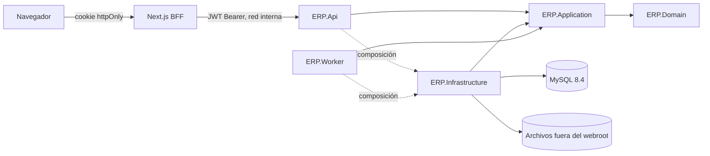
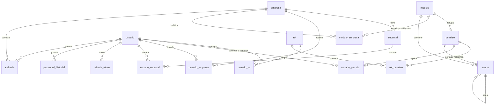
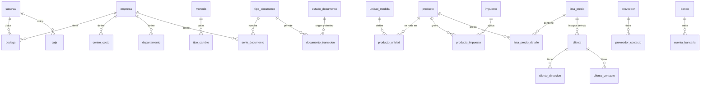
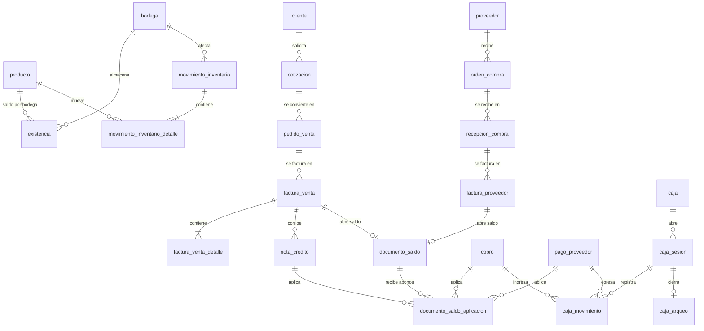
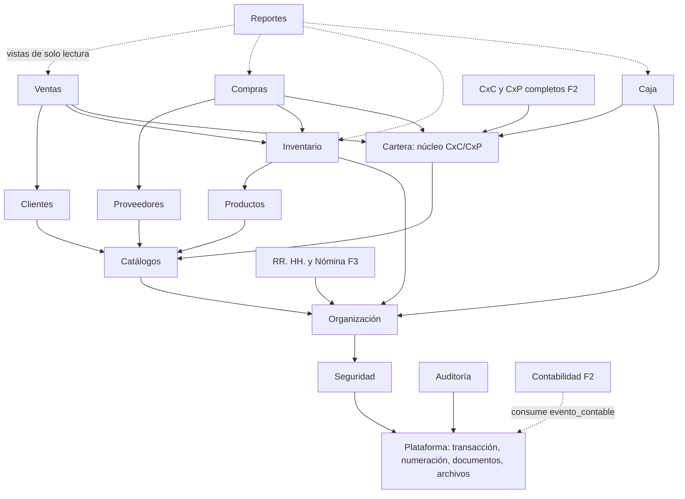
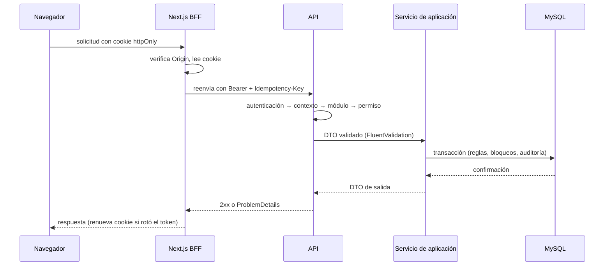
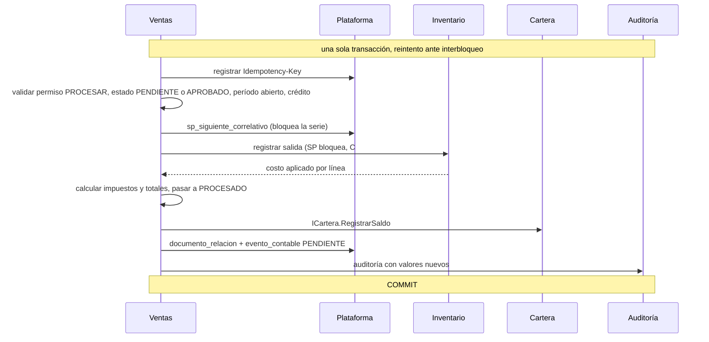

# ERP Modular — Diseño maestro (etapa C0)

> Entregable de la etapa **Diseño** (`ESPECIFICACION.md §C0`). No contiene código de producción.
> Estado: **revisión 2 (2026-10-09)**, alineada con `CLAUDE.md` y `ESPECIFICACION.md` tras las correcciones del dueño a los hallazgos de la revisión 1. Fase 0 no se inicia hasta que el dueño lo pida.
> Referencias: `E §Bn` = sección de `ESPECIFICACION.md` · `C §n` = sección de `CLAUDE.md` · `ADR-nnn` = entrada de `DECISIONES.md`.

Contenido: [A Análisis](#a-análisis) · [B Faltantes](#b-faltantes) · [C Arquitectura](#c-arquitectura) · [D Estructura física](#d-estructura-física) · [E Modelo de datos](#e-modelo-de-datos) · [F Dependencias entre módulos](#f-dependencias-entre-módulos) · [G Flujo de información](#g-flujo-de-información) · [H Preparación contable](#h-preparación-contable) · [I Preparación RR. HH.](#i-preparación-rr-hh) · [J Roadmap](#j-roadmap-y-criterios-de-aceptación) · [K Riesgos](#k-riesgos) · [L Decisiones](#l-decisiones-arquitectónicas) · [Preguntas abiertas](#preguntas-abiertas)

---

## A. Análisis

La especificación ya resolvió los duplicados del texto original (`E §A3`). Esta sección registra lo que la revisión 1 encontró inconsistente, ambiguo o sin dueño, y cómo quedó. **Resuelto** = el dueño ya lo corrigió en `CLAUDE.md` o en la especificación; el resto trae la resolución que se aplica por defecto.

### A.1 Inconsistencias y contradicciones

| # | Hallazgo | Resolución |
|---|---|---|
| A1 | **El orden de secciones de `database.sql` rompía las FK** (SEGURIDAD antes que ORGANIZACIÓN). | **Resuelto en `C §7`**: orden por dependencia de FK (CONFIGURACIÓN → ORGANIZACIÓN → SEGURIDAD → CATÁLOGOS → …) y sección final `RELACIONES DIFERIDAS` para lo que deba apuntar hacia adelante. Detalle en [E.1](#e1-secciones-de-databasesql) y ADR-011. |
| A2 | **Faltan secciones en `E §B2`** para tablas que la propia especificación exige: módulos y menú, documentos (tipos, series, estados, relación, `evento_contable`, idempotencia), archivos, notificaciones, `esquema_version`, triggers, cartera. | Mapa completo de secciones en [E.1](#e1-secciones-de-databasesql). |
| A3 | **`usuario_bodega` y `usuario_caja` figuraban como tablas de Fase 0**, antes de que existieran `bodega` y `caja`. | **Resuelto en `E §B3`**: se crean en 1A. En Fase 0 el contexto de trabajo es empresa + sucursal. |
| A4 | **El orden de etapas de `C §2` no incluye 1H (FEL)**, que sí existe en `E §C9`. | 1H es una etapa **flotante**: se puede ejecutar en cualquier momento después de 1E, cuando el dueño elija certificador. Es **bloqueante para facturar en producción**, no para avanzar a 1F/1G. |
| A5 | **"Un módulo no consulta tablas de otro" (`C §6`) frente a las FK y a los listados/reportes** que necesitan datos de varios módulos (factura → cliente → producto). | Regla precisa en [C.3](#c3-reglas-entre-módulos): FK entre módulos permitidas (integridad); escritura solo por la interfaz del dueño; lectura cruzada solo por contrato de consulta del dueño o por vistas de solo lectura de Reportes; los documentos guardan *snapshot* de los datos que deben quedar congelados. (ADR-012) |
| A6 | **"Reglas de negocio en C#" frente a "movimientos de inventario en SP"**: el costo promedio es regla de negocio. | **Resuelto en `C §6`**: el costeo vive en C#; el SP de inventario/caja solo bloquea la fila (`FOR UPDATE`) y persiste el resultado que el backend ya calculó. Forma concreta en [C.4](#c4-transacciones-y-concurrencia) y ADR-013. |
| A7 | **Columnas de auditoría "en toda tabla de negocio" (`C §7`) frente a tablas inmutables** (`movimiento_inventario`, `auditoria`, `evento_contable`, historiales). | Las tablas de solo inserción llevan solo `creado_en`, `creado_por`. Las tablas puente puras (`rol_permiso`, `usuario_rol`) llevan `creado_en`, `creado_por`; su historial queda en `auditoria`. |
| A8 | **Las acciones de permiso no cubrían "procesar" un documento** ni operaciones propias de caja; `{MODULO}_PRUEBAS` (`E §B4`) no sigue el patrón de tres partes. | **`PROCESAR` resuelto en `C §8`** (transición PENDIENTE/APROBADO → PROCESADO, distinta de `CREAR`). Queda por defecto: acciones propias de un recurso (`ABRIR`, `CERRAR`, `ARQUEAR`, `DESCUENTO`) como excepción documentada en el catálogo, y `{MODULO}_PRUEBAS` como única excepción al patrón. (ADR-019) |
| A9 | **`middleware.ts` cambió de nombre en Next.js 16.** | **Resuelto en `C §11`**: se usa `proxy.ts`. Solo mejora la UX; no es seguridad. |
| A10 | **El crédito de Fase 1 no tenía dueño**: con el saldo como columna de la factura, Caja escribiría en tablas de Ventas y Fase 2 tendría que modificarlas. | **Resuelto en `E §A3` y `§B14a`**: módulo **Cartera** desde 1D, dueño de `documento_saldo` y `documento_documento_saldo_aplicacion`, usado por Compras, Ventas y Caja a través de `ICartera`. Detalle en [H](#h-preparación-contable) y ADR-014. |
| A11 | **Lista de módulos distinta en `C §6` (17) y `E §B1`** (agrega Configuración, Menú, Control de módulos, Archivos, Notificaciones, Integraciones). No queda claro cuáles se "liberan". | Dos categorías: **módulos funcionales** (fila en `modulo`, se liberan, tienen permisos y menú) y **servicios de plataforma** (siempre activos, sin estado de liberación). Lista en [C.2](#c2-módulos). |
| A12 | **El equipo de desarrollo no coincide con el stack fijado**: hay .NET SDK 9.0.312 (se requiere 10), el servicio instalado es `MySQL80` (se requiere 8.4 LTS) y Git no está instalado. | **Criterio fijado en `C §15`**: .NET SDK 10, Git y MySQL 8.4 en otro puerto (3307), sin tocar el `MySQL80` existente. Instalación pendiente; ver `PROGRESO.md`. |
| A23 | **`E §B2` conserva el orden antiguo** (SEGURIDAD antes que ORGANIZACIÓN) y no lista CARTERA ni `RELACIONES DIFERIDAS`; contradice a `C §7`. | Prevalece `C §7` (regla permanente y corrección más reciente). Conviene corregir esa línea de `E §B2`. |
| A24 | **Dos tablas de aplicación**: `E §B14` punto 4 habla de `cobro`/`pago_proveedor` + `*_aplicacion`, y `E §B14a` define `documento_documento_saldo_aplicacion`. | Una sola: `documento_documento_saldo_aplicacion` (Cartera). `cobro` y `pago_proveedor` (Caja) no tienen tabla de aplicación propia; el reparto de un cobro entre documentos vive en Cartera. |
| A25 | **Ventas de contado y Cartera**: `E §B14a` dice "una fila por documento con saldo" y Caja no conoce a Ventas. No queda dicho contra qué se aplica el cobro de una factura de contado. | Toda factura procesada registra su saldo, también la de contado; el cobro inmediato lo salda en la misma transacción. Así Caja tiene un único camino (`ICartera.AplicarPago`). A confirmar en el plan de 1D. |

### A.2 Ambigüedades

| # | Ambigüedad | Opción conservadora adoptada |
|---|---|---|
| A13 | **Unicidad y baja lógica**: ¿se puede reutilizar el código de un registro inactivo? | No. `activo = 0` significa *inhabilitado*, y su código sigue reservado → `UNIQUE(empresa_id, codigo)` simple. Solo donde la reutilización sea necesaria se usa columna generada. |
| A14 | **Catálogos globales con `empresa_id` nulo** (`E §B9`): en MySQL un `UNIQUE` no detecta duplicados cuando hay `NULL`. | Columna generada `empresa_clave = IFNULL(empresa_id, 0)` dentro del índice único. |
| A15 | **`persona`** aparece solo en `E §B15` (empleado). ¿Clientes y proveedores comparten una tabla de terceros? | No se unifican. `cliente` y `proveedor` son tablas separadas (módulos separados); un mismo NIT puede existir en ambas. `persona` se crea en Fase 3 para empleados. |
| A16 | **Dónde viaja el contexto empresa/sucursal** (`E §B3`). | En el JWT de acceso como *claims* (`emp`, `suc`), emitidos por login o por `POST /seguridad/sesion/contexto`. El servidor los **revalida en cada solicitud** contra `usuario_empresa`/`usuario_sucursal`. El cliente no envía el contexto por cabecera. |
| A17 | **Fecha retroactiva y costo promedio** (`E §C4`). | Los movimientos se costean en **orden de registro**, no de fecha de documento; no hay recálculo hacia atrás. `fecha_bloqueo` limita qué tan atrás se puede fechar. Se detalla en 1C. |
| A18 | **Anular un documento con dependientes** (factura con cobro aplicado, recepción ya facturada). | Se rechaza (422) hasta anular primero el dependiente, en orden inverso al flujo. Sin anulación en cascada. |
| A19 | **`fecha_bloqueo` se implementa en 1A**, pero no hay documentos hasta 1C. | 1A entrega la configuración y el servicio de dominio `IPeriodoAbierto`; cada documento lo invoca desde su etapa. |
| A20 | **Régimen tributario y precios con IVA incluido** (`E §B11`, `§B20`): cambian el cálculo de cada línea. | El motor de impuestos lee el régimen de la empresa y `lista_precio.incluye_impuesto`; ningún porcentaje va en código. Los valores iniciales se confirman con el contador (P6). |
| A21 | **Estado como `estado_id` (`E §B2`) o como código (`E §B7`)**. | `estado_id` con FK a `estado_documento`, que tiene `codigo` estable. El dominio usa un enumerado mapeado por `codigo`; una prueba verifica que catálogo y enumerado coincidan. |
| A22 | **Recuperación de contraseña por correo en Fase 0** exige un servidor SMTP que aún no existe. | Puerto `ICorreo` con dos adaptadores: SMTP y "archivo local" para desarrollo. Sin SMTP configurado la función queda operativa en desarrollo y documentada como pendiente para producción. |

### A.3 Dependencias de construcción

- **Fase 0 fija todos los patrones** (transacción, permisos, auditoría, CRUD, errores, BFF). Un error ahí se multiplica por cada módulo: su rebanada vertical (Sucursales) se revisa con más cuidado que ninguna otra.
- `tipo_documento`, `serie_documento`, `estado_documento`, impuestos, monedas y unidades (1A) son prerrequisito de **todo** documento (1C–1F).
- Productos (1B) → Inventario (1C) → Compras (1D) y Ventas (1E). Compras antes que Ventas porque genera el costo que Ventas consume.
- Cartera nace en 1D (primer documento a crédito) y la consumen 1E y 1F.
- `evento_contable` y `documento_relacion` nacen en 1C (primer documento procesado: movimiento de inventario).
- Archivos (1B) es prerrequisito de imágenes de producto, importación masiva y PDF.

---

## B. Faltantes

Se parte de `E §B26`, que se da por válido. Aquí solo lo **adicional** o lo que cambia de prioridad.

### Crítico (sin esto no se puede construir o se pierde dinero/datos)

| Faltante | Etapa |
|---|---|
| Equipo de desarrollo con .NET 10 SDK, MySQL 8.4 (puerto 3307) y Git (A12, `C §15`) | antes de 0 |
| Usuario MySQL con DDL **solo para pruebas** en la instancia 8.4, para las bases `erp_test_*` (ya autorizadas en `C §15`) | antes de 0 |
| Unidad de trabajo compartida: una sola transacción que cruza módulos (Ventas → Inventario → Cartera → Auditoría) | 0 |
| Régimen tributario de la empresa y regla de precio con/sin IVA (A20) | 1A |
| Regla de anulación con documentos dependientes (A18) | 1C |
| Otorgamientos de MySQL **por tabla**, para que la aplicación no tenga `UPDATE`/`DELETE` sobre las tablas inmutables | 0 |
| Protección CSRF en el BFF (la sesión va en cookie) | 0 |
| Saldos iniciales de clientes y proveedores, si se arranca con cartera viva | 1G (carga inicial) |

### Importante

- Sesión: listado y cierre de sesiones activas del usuario; invalidación de la caché de permisos al cambiar roles o estado de módulo.
- Respuesta uniforme en login y recuperación (no revelar si el usuario existe).
- Productos **no inventariables** (servicios) y bandera `maneja_inventario`.
- Venta con **varias formas de pago** y cálculo de vuelto (1F).
- Límite de descuento por rol y regla de venta bajo costo (1E).
- Vendedor en documentos de venta (catálogo simple; comisiones a futuro).
- Formatos de impresión: carta y ticket de 80 mm **[CONFIRMAR]**.
- Consumidor final "CF" y su monto máximo como parámetro con vigencia.
- Tipo de cambio faltante para la fecha: se rechaza el documento, no se asume 1.
- Límite de filas y ejecución en segundo plano para exportaciones grandes.
- Cabecera `Content-Security-Policy` en el frontend.
- Retención de `solicitud_idempotente`, `refresh_token` e `intento_login` (limpieza por el Worker en 1G; manual documentada antes).

### Recomendado

- Historial de cambios visible en cada registro (lectura de `auditoria` por entidad).
- "Duplicar documento" en cotizaciones y órdenes de compra.
- Plantillas de impresión configurables por empresa.
- Ambiente de QA separado desde 1C, no solo al final.
- Búsqueda global (cliente, producto, documento).

### Futuro

Lo de `E §B26`, más: kits/combos, comisiones de vendedores, precios por volumen, múltiples listas por cliente, y aprobaciones por monto.

---

## C. Arquitectura

### C.1 Estilo

**Monolito modular en capas** (ADR-010 / `E §A2` D10): un solo proceso de API, una sola base de datos, módulos aislados por carpeta y espacio de nombres, y dependencias verificadas por pruebas automáticas.



| Proyecto | Contiene | No puede |
|---|---|---|
| `ERP.Domain` | Entidades, objetos de valor (`Dinero`, `Cantidad`, `Nit`), estados y transiciones, cálculos puros (impuestos, costo promedio, conversión de unidades) | Referenciar ningún paquete ni otro proyecto |
| `ERP.Application` | Casos de uso (un servicio por recurso), DTO, validadores, puertos (`I…Repository`, `IClock`, `IUnitOfWork`, `IAuditoria`, `IProveedorFel`…), contratos entre módulos | Referenciar Dapper, MySqlConnector ni ASP.NET |
| `ERP.Infrastructure` | Repositorios Dapper, JWT, hash de contraseñas, archivos, correo, reloj, adaptadores de integración | Ser referenciado por Domain o Application |
| `ERP.Api` | Controladores delgados, middleware, filtros de autorización, `Program.cs` | Contener reglas de negocio ni SQL |
| `ERP.Worker` | Tareas programadas (desde 1G) | Exponer HTTP |

**Sin MediatR ni AutoMapper** (`C §4`): los controladores llaman al servicio de aplicación directamente y el mapeo se escribe a mano.

### C.2 Módulos

**Módulos funcionales** (tienen fila en `modulo`, estado de liberación, permisos y menú):

| Código | Módulo | Fase | Etapa |
|---|---|---|---|
| `SEGURIDAD` | Usuarios, roles, permisos, sesiones, módulos, menú | 1 | 0 |
| `AUDITORIA` | Bitácora y consulta | 1 | 0 (base) / 1G |
| `ORGANIZACION` | Empresas, sucursales, bodegas, cajas, departamentos, centros de costo | 1 | 0 / 1A |
| `CATALOGOS` | Monedas, impuestos, unidades, formas de pago, bancos, tipos de documento y series, configuración de negocio | 1 | 1A |
| `CLIENTES` · `PROVEEDORES` · `PRODUCTOS` | Maestros | 1 | 1B |
| `INVENTARIO` | Existencias, movimientos, kardex, traslados, ajustes | 1 | 1C |
| `COMPRAS` | Órdenes, recepciones, facturas de proveedor, devoluciones | 1 | 1D |
| `VENTAS` | Cotizaciones, pedidos, facturas, notas, devoluciones | 1 | 1E |
| `CAJA` | Sesiones de caja, cobros, pagos, arqueo | 1 | 1F |
| `REPORTES` | Reportería y exportación | 1 | 1G |
| `CXC` · `CXP` | Núcleo "Cartera" desde 1D; funcionalidad completa en Fase 2 | 2 | 1D (núcleo) / 2 |
| `CONTABILIDAD` | Partidas, libros, cierres | 2 | 2 |
| `RRHH` · `NOMINA` | Empleados y nómina | 3 | 3 |

`SEGURIDAD`, `AUDITORIA` y `ORGANIZACION` no pueden pasar a un estado que bloquee al administrador (regla de dominio: no se suspenden).

**Servicios de plataforma** (carpeta `Plataforma`, siempre activos, sin fila en `modulo`): transacción y reintentos, idempotencia, numeración, estados y relación de documentos, `evento_contable`, archivos, notificaciones, correo, configuración técnica, localización Guatemala (`Localizacion/GT`).

### C.3 Reglas entre módulos

1. **Escritura**: una tabla solo la escribe el repositorio de su módulo dueño.
2. **Colaboración**: un módulo llama a otro por una interfaz declarada en `Application/<Modulo>/Contratos` (ej. `IInventarioMovimientos.Registrar(...)`, `ICartera.RegistrarSaldo(...)`). La llamada es en proceso y **participa en la transacción en curso**.
3. **Lectura cruzada**: por el contrato de consulta del dueño (ej. `IProductosConsulta.ObtenerParaDocumento(ids)`), nunca con un `JOIN` propio a tablas ajenas. Excepción única: el módulo `REPORTES` lee **vistas de solo lectura**.
4. **FK entre módulos**: permitidas y deseadas (integridad).
5. ***Snapshot***: el documento copia lo que debe quedar congelado (nombre y NIT del cliente, descripción del producto, precio, costo, porcentaje de impuesto).
6. **Sin dependencias circulares**: el grafo de [F](#f-dependencias-entre-módulos) es acíclico y lo verifica una prueba de arquitectura.
7. **Hacia las fases futuras** solo hay salida por `evento_contable` (outbox): Fase 1 nunca llama a Contabilidad.

### C.4 Transacciones y concurrencia

- `IUnitOfWork` con alcance por solicitud: una conexión y una transacción compartidas por todos los repositorios que intervienen. El servicio de aplicación la abre con `EjecutarEnTransaccion(...)`; los contratos de otros módulos la reutilizan.
- Operación crítica (`C §9`): validar → bloquear filas en **orden fijo** (serie → existencias por `producto_id, bodega_id` ascendente → saldo de cartera → sesión de caja) → correlativo → efectos → auditoría → `evento_contable` → confirmar.
- **Procedimientos almacenados** (`C §6`): `sp_siguiente_correlativo` bloquea la serie y devuelve el número. En inventario y caja el patrón es de dos llamadas dentro de la transacción: un SP **bloquea y devuelve** la fila (`existencia`, sesión de caja); el dominio C# valida y calcula (saldo, costo promedio, stock negativo); otro SP **persiste** el resultado ya calculado. Ningún SP calcula ni decide.
- **Reintento acotado** (3 intentos, espera creciente) ante error 1213 (interbloqueo) y 1205 (espera de bloqueo): se repite la transacción completa.
- **Idempotencia**: la fila de `solicitud_idempotente` se inserta dentro de la misma transacción con `UNIQUE(usuario_id, endpoint, clave)`. Un reenvío simultáneo espera en el índice y luego recibe la respuesta guardada; misma clave con cuerpo distinto → 422.
- **Edición concurrente**: `UPDATE … WHERE id = @id AND version_fila = @version`; cero filas afectadas → 409.
- Conexión siempre en UTC (`time_zone = '+00:00'`), aislamiento `REPEATABLE READ`.

### C.5 Seguridad en el servidor

Cadena de `C §8`, con su punto de implementación:

| Paso | Dónde | Falla |
|---|---|---|
| 1. Autenticado | `JwtBearer` + `[Authorize]` | 401 |
| 2. Contexto empresa/sucursal válido | Middleware `ContextoTrabajo` (revalida *claims* contra `usuario_empresa/sucursal`) | 403 `CONTEXTO_INVALIDO` |
| 3. Módulo habilitado | Filtro de `[RequierePermiso]`: el módulo se deduce del prefijo del código; estado efectivo = el más restrictivo entre global y empresa | 403 `MODULO_NO_DISPONIBLE` |
| 4. Permiso | Mismo filtro: denegación de usuario > concesión de usuario > unión de roles, con vigencia | 403 `PERMISO_DENEGADO` |
| 5. Regla de negocio | Servicio de aplicación / dominio | 422 |

- Permisos y estado de módulos se resuelven en servidor con caché en memoria, invalidada por un contador `seguridad_version` que sube con cada cambio de roles, permisos o estado de módulo. No viajan en el JWT.
- Contraseñas: PBKDF2-HMAC-SHA512 del propio .NET con formato versionado (ADR-015). Refresh token opaco de 256 bits, guardado como hash SHA-256, con rotación por familia y revocación de toda la familia si se reutiliza.
- Limitación de tasa en login y recuperación (integrada en ASP.NET Core).
- Prueba automática por reflexión: todo método de acción tiene `[RequierePermiso]` o `[AllowAnonymous]` explícito, y todo código usado existe en el catálogo sembrado.

### C.6 Frontend

- Next.js 16 (App Router). El navegador solo conoce rutas del propio Next: `app/api/bff/[...ruta]/route.ts` reenvía a la API interna agregando el `Authorization` desde la cookie.
- Cookies `httpOnly`, `Secure`, `SameSite=Strict`: acceso (corta) y refresh (ruta restringida a `/api/bff/auth`). Renovación transparente con una sola solicitud en vuelo.
- CSRF: `SameSite=Strict` + verificación de `Origin` en toda solicitud mutadora del BFF.
- Estado de servidor con TanStack Query; formularios con React Hook Form + Zod (validación de UX; el servidor valida de nuevo).
- Tema: un único módulo de tokens (variables CSS + tema de Tailwind + `marca.ts` con nombre y logo). Una regla de *lint* rechaza colores y tamaños fijos fuera de `components/ui` y `components/layout`. Brief en `DISENO-UI.md` (se crea en Fase 0).
- Tipos en `src/types` que reflejan los DTO; se mantienen a mano y se revisan en la misma tarea que cambie un DTO (`C §2.7`).

### C.7 API, errores y observabilidad

- `ProblemDetails` global con `errorCode`, `traceId` y `errors`. Excepciones de dominio tipadas → 404 / 409 / 422; cualquier otra → 500 sin detalle.
- *Correlation id* por solicitud: cabecera de respuesta, propiedad en cada línea de Serilog y `auditoria.operacion_id`.
- OpenAPI integrado de .NET 10, expuesto solo en Desarrollo y QA.

---

## D. Estructura física

Amplía `C §5`. Los módulos se repiten como carpeta en cada proyecto.

```
ERP/
├── backend/
│   ├── ERP.sln · global.json · Directory.Build.props · Directory.Packages.props
│   ├── src/
│   │   ├── ERP.Domain/
│   │   │   ├── Comun/                 Dinero, Cantidad, Resultado, excepciones de dominio
│   │   │   ├── Seguridad/ Organizacion/ Catalogos/ …   (una carpeta por módulo)
│   │   │   └── Localizacion/GT/       Nit, Cui, reglas fiscales de Guatemala
│   │   ├── ERP.Application/
│   │   │   ├── Comun/                 paginación, IUnitOfWork, IClock, IUsuarioActual, IAuditoria
│   │   │   ├── Plataforma/            numeración, idempotencia, documentos, archivos, notificaciones
│   │   │   └── <Modulo>/
│   │   │       ├── Contratos/         interfaces que el módulo ofrece a otros
│   │   │       ├── Dtos/ · Validadores/ · Servicios/
│   │   │       └── Puertos/           repositorios y adaptadores que necesita
│   │   ├── ERP.Infrastructure/
│   │   │   ├── Persistencia/          conexión, UnitOfWork, reintentos, manejadores de tipos Dapper
│   │   │   ├── <Modulo>/              repositorios Dapper
│   │   │   ├── Seguridad/             JWT, hash, refresh tokens
│   │   │   └── Integraciones/         Correo/, Archivos/, Fel/
│   │   ├── ERP.Api/
│   │   │   ├── Controllers/<Modulo>/
│   │   │   ├── Seguridad/             RequierePermisoAttribute, filtros, ContextoTrabajo
│   │   │   ├── Middleware/            errores, correlation id, cabeceras
│   │   │   ├── Properties/launchSettings.json
│   │   │   └── Program.cs · appsettings.json · appsettings.Example.json
│   │   └── ERP.Worker/                (1G)
│   └── tests/
│       ├── ERP.UnitTests/             dominio, cálculos, arquitectura, "todo endpoint tiene permiso"
│       └── ERP.IntegrationTests/      base creada desde database.sql; API, seguridad, concurrencia
├── frontend/
│   └── src/
│       ├── app/
│       │   ├── (publico)/login · recuperar · cambiar-password
│       │   ├── (app)/<modulo>/<recurso>/     pantallas protegidas
│       │   └── api/bff/[...ruta]/route.ts
│       ├── components/ ui/ · layout/ · <modulo>/
│       ├── services/ · hooks/ · contexts/ · types/ · utils/
│       ├── theme/                     tokens.css · marca.ts
│       └── proxy.ts                   (nombre vigente en Next.js 16; ver A9)
├── database/
│   ├── database.sql
│   ├── updates/AAAAMMDD_NN_descripcion.sql
│   ├── usuarios-ejemplo.sql           plantilla de usuarios y otorgamientos (sin contraseñas)
│   └── demo-data.sql
├── deploy/                            (1G)
└── documentation/
    ├── ESPECIFICACION.md · DISENO.md · DECISIONES.md · PROGRESO.md
    └── DISENO-UI.md · DESPLIEGUE-WINDOWS.md · (por etapa) MODULO-<nombre>.md
```

---

## E. Modelo de datos

Entidades y relaciones principales. Las columnas completas se definen en el plan de cada etapa; aquí se fija **qué existe, quién es el dueño y cómo se relaciona**.

### E.1 Secciones de `database.sql`

Orden por dependencia de FK, según `C §7` (una sección no referencia tablas de una sección posterior), con lo que faltaba en `E §B2` (A2, A23):

| Sección | Tablas principales | Etapa |
|---|---|---|
| BASE | creación de la base, `esquema_version` | 0 |
| CONFIGURACIÓN | `configuracion` (por empresa; su FK a `empresa` va en RELACIONES DIFERIDAS), `seguridad_version` | 0 / 1A |
| ORGANIZACIÓN | `empresa`, `sucursal`, `bodega`, `caja`, `departamento`, `centro_costo` — sin FK a `usuario` | 0 / 1A |
| SEGURIDAD | `usuario`, `rol`, `permiso`, `rol_permiso`, `usuario_rol`, `usuario_permiso`, `usuario_empresa`, `usuario_sucursal`, `refresh_token`, `intento_login`, `politica_password`, `password_historial`, `token_recuperacion`, `modulo`, `modulo_empresa`, `menu`, `solicitud_idempotente`; en 1A `usuario_bodega`, `usuario_caja` | 0 / 1A |
| CATÁLOGOS | `moneda`, `tipo_cambio`, `impuesto`, `unidad_medida`, `forma_pago`, `banco`, `cuenta_bancaria`, `tipo_documento`, `serie_documento`, `estado_documento`, `documento_transicion`, categorías, marcas, tipos | 1A |
| CLIENTES · PROVEEDORES | `cliente`, `proveedor` + contactos, direcciones, condiciones de crédito | 1B |
| PRODUCTOS | `producto`, `producto_unidad`, `producto_impuesto`, `producto_codigo_barras`, `lista_precio`, `lista_precio_detalle`, `archivo` | 1B |
| INVENTARIO | `existencia`, `movimiento_inventario`, `movimiento_inventario_detalle`, `reserva_inventario`, documentos de ajuste y traslado | 1C |
| DOCUMENTOS (nueva) | `documento_relacion`, `evento_contable` | 1C |
| CARTERA (nueva) | `documento_saldo`, `documento_saldo_aplicacion` | 1D |
| COMPRAS | `orden_compra`, `recepcion_compra`, `factura_proveedor`, `devolucion_compra` (+ detalle) | 1D |
| VENTAS | `cotizacion`, `pedido_venta`, `factura_venta`, `nota_credito`, `nota_debito`, `devolucion_venta` (+ detalle) | 1E |
| CAJA | `caja_sesion`, `caja_movimiento`, `cobro`, `cobro_detalle_pago`, `pago_proveedor`, `caja_arqueo` | 1F |
| AUDITORÍA | `auditoria`, `auditoria_acceso` | 0 |
| NOTIFICACIONES (nueva) | `notificacion`, `tarea_ejecucion` | 1G |
| VISTAS · PROCEDIMIENTOS · FUNCIONES · TRIGGERS | `sp_siguiente_correlativo`, SP de bloqueo y de persistencia de inventario/caja, vistas de listado y kardex | 0+ |
| SEEDS | permisos, rol administrador, módulos, menú, empresa y sucursal iniciales | 0+ |
| RELACIONES DIFERIDAS | `ALTER TABLE … ADD CONSTRAINT` solo para FK que por negocio apunten a una sección posterior (hoy: `configuracion.empresa_id`) | 0+ |

Las columnas `creado_por` y `modificado_por` guardan el `id` del usuario **sin FK**: están en todas las tablas (incluidas las de ORGANIZACIÓN, que van antes que `usuario`) y una FK con su índice en cada una costaría más de lo que aporta. La integridad de esos valores la da el backend, que los toma siempre del usuario autenticado. (ADR-011)

Reglas físicas adicionales a `C §7`: intercalación `utf8mb4_0900_ai_ci` (búsqueda sin distinguir tildes ni mayúsculas); `version_fila INT UNSIGNED`; identificadores `BIGINT UNSIGNED` en BD y `long` en C#; JSON nativo en `auditoria`.

### E.2 Seguridad, organización y control de módulos (Fase 0)



### E.3 Maestros (1A–1B)



### E.4 Inventario y documentos (1C–1F)



Las relaciones entre documentos del diagrama (cotización → pedido → factura, etc.) **no** son FK directas en las cabeceras: se guardan en `documento_relacion` para admitir parcialidades y varios orígenes. `movimiento_inventario` y `evento_contable` referencian a su documento de origen por el par (`tipo_documento_id`, `documento_id`), sin FK, porque el origen puede ser cualquier tabla.

Puntos de diseño que fijan el resto:

- **`existencia(empresa_id, bodega_id, producto_id)`** con cantidad, cantidad reservada y costo promedio: es la fila que se bloquea. `movimiento_inventario_detalle` guarda cantidad, costo unitario, costo total y **saldo resultante** (cantidad y costo) → el kardex se lee sin recalcular.
- **Cabecera transaccional común** (`E §B2`): mismas columnas en todos los documentos, sin tabla "documento" genérica. Cada documento conserva su tabla propia (más simple de consultar y de proteger con permisos).
- **`documento_saldo`** (`E §B14a`): una fila por documento con saldo, creada al procesarlo, con tipo y `id` del documento, tercero (`CLIENTE`/`PROVEEDOR`), moneda, monto original, saldo pendiente, vencimiento y estado (`PENDIENTE`/`PARCIAL`/`SALDADO`/`ANULADO`). `documento_saldo_aplicacion` registra cada abono con su origen (`COBRO`/`PAGO`/`NOTA_CREDITO`/`NOTA_DEBITO`) y es de solo inserción: un abono se revierte con otra fila. Solo Cartera lee y escribe estas tablas; `saldo_pendiente` se actualiza con la fila bloqueada.

---

## F. Dependencias entre módulos

Una flecha `A → B` significa "A usa contratos de B". No hay ciclos.



Todos los módulos usan además Seguridad (usuario actual, permisos), Auditoría (`IAuditoria`) y Plataforma; no se dibuja para no saturar.

Consecuencias que conviene tener presentes:

- **Caja no conoce a Ventas ni a Compras.** Cobra y paga con `ICartera.AplicarPago`. Una venta de contado registra su saldo y lo salda en la misma transacción cuando el cobro se registra junto con la factura (A25).
- **Ventas y Compras no conocen a Caja.** Quien orquesta "facturar y cobrar" es un caso de uso del lado de Caja/punto de venta que llama a Ventas y luego a su propio cobro, en una sola transacción.
- **Inventario no conoce a Compras ni a Ventas**: recibe movimientos con el tipo y el identificador del documento de origen.
- Fase 2 y Fase 3 solo **agregan** flechas hacia módulos existentes; ningún módulo de Fase 1 apunta hacia ellas.

---

## G. Flujo de información

### G.1 Toda solicitud



### G.2 Procesar una factura de venta (operación crítica tipo)



Anular = mismo recorrido en sentido inverso: contra-movimiento de inventario al costo original, cancelación del saldo, `evento_contable` de anulación, estado `ANULADO` con motivo. Con FEL activo (1H), la anulación fiscal ante el certificador precede a la interna.

### G.3 Flujos de negocio

```
Venta:   Cotización → Pedido (reserva opcional) → Factura → saldo → Cobro → Caja → evento_contable
Compra:  Orden de compra → Recepción (entra inventario) → Factura proveedor → saldo → Pago → Caja → evento_contable
Bodega:  Ajuste / Traslado / Saldo inicial → movimiento_inventario → evento_contable
```

Los maestros fluyen en un solo sentido (Catálogos → Productos/Clientes/Proveedores → documentos) y los documentos copian lo que necesitan congelar.

---

## H. Preparación contable

Objetivo: que Fase 2 se construya **sin modificar tablas transaccionales de Fase 1**.

| Mecanismo | Qué deja listo | Etapa |
|---|---|---|
| Cabecera transaccional común | Moneda, tipo de cambio, totales en moneda del documento y local, `centro_costo_id`, condición de pago | 1C+ |
| `evento_contable` (outbox) | Hecho contable con tipo de evento, documento, fecha contable, montos desglosados (base, impuesto por tipo, costo, descuento), moneda, tercero, centro de costo, estado `PENDIENTE` | 1C+ |
| `documento_relacion` | Rastro completo cotización → cobro, con parcialidades | 1C+ |
| Costo histórico por línea | Costo de ventas exacto sin recalcular | 1C+ |
| *Snapshot* de impuestos por línea | Libros de compras y ventas sin depender del catálogo actual | 1D+ |
| Módulo Cartera (`documento_saldo`, `documento_saldo_aplicacion`) | Saldos, vencimientos, pagos parciales y anticipos; base de estados de cuenta y envejecimiento | 1D+ |
| `fecha_bloqueo` por empresa | Cierre de períodos | 1A |
| `cuenta_bancaria`, `forma_pago` | Destino contable de cobros y pagos | 1A |

Reglas para Fase 2:

- El procesador de `evento_contable` (Worker) traduce cada evento a una partida con una **matriz de configuración** (tipo de evento + atributos → cuentas). La matriz y el catálogo de cuentas son tablas nuevas de Fase 2.
- El evento lleva montos suficientes para armar la partida **sin volver a leer el documento**; así un cambio futuro en Ventas no rompe Contabilidad.
- Los eventos son inmutables; solo cambia su estado de proceso (`PENDIENTE → CONTABILIZADO | ERROR`) y la referencia a la partida. Una anulación es un evento nuevo, no una edición.
- Los eventos generados antes de liberar Fase 2 quedan `PENDIENTE` y se pueden contabilizar en bloque al arrancar, o descartarse con una partida de apertura: decisión de Fase 2.

---

## I. Preparación RR. HH.

Fase 3 tiene diseño detallado propio antes de implementarse (`E §C11`). En Fases 0–1 solo se garantiza que **nada lo impida**:

| Preparación | Etapa |
|---|---|
| `departamento` y `centro_costo` con jerarquía (`padre_id`) y `empresa_id` | 1A |
| `usuario` sin datos laborales: `empleado` tendrá `usuario_id` opcional, no al revés | 0 |
| Permisos con módulo propio y auditoría de **lectura** disponible (`accion = LEER`) para datos sensibles | 0 |
| Infraestructura de archivos con metadatos por entidad (expedientes) | 1B |
| Parámetros con vigencia (`valor`, `vigente_desde`, `vigente_hasta`) como patrón de `configuracion` e `impuesto`; el mismo patrón servirá a salario mínimo, cuotas IGSS, etc. | 1A |
| Carpeta `Localizacion/GT` aislada del núcleo | 0 |
| `evento_contable` admite eventos de nómina sin cambios | 1C |
| Bancos y cuentas bancarias (pago de nómina) | 1A |

En Fase 3 se crean `persona`, `empleado`, `puesto`, el historial laboral de solo inserción y el motor de conceptos. Ninguna tabla de Fase 1 cambia.

---

## J. Roadmap y criterios de aceptación

Todas las etapas cumplen además la definición de terminado de `C §13` (BD en `database.sql` + `updates/`, permisos, auditoría, pruebas, compila, flujo probado, documentación). Aquí solo lo **específico**.

| Etapa | Entrega | Criterios de aceptación específicos |
|---|---|---|
| **0 Fundamentos** | Solución, frontend, BD inicial, autenticación, autorización, módulos, menú, auditoría, CRUD de Sucursales | Los 7 de `E §C1`, más: prueba de arquitectura verde · reutilizar un refresh token revoca la familia · editar con `version_fila` vieja → 409 · el usuario MySQL de la app no puede `UPDATE`/`DELETE` en `auditoria` |
| **1A Maestros** | Organización completa, catálogos, impuestos, monedas, series, configuración | `sp_siguiente_correlativo` sin saltos ni duplicados con 50 hilos concurrentes · impuestos y parámetros con vigencia (consulta "vigente a la fecha" probada) · `fecha_bloqueo` consultable por `IPeriodoAbierto` · cambiar el estado de un módulo exige motivo y queda auditado |
| **1B Clientes, proveedores, productos** | Maestros, archivos, importación masiva | NIT y CUI validados (dígito verificador) con casos de prueba · conversión de unidades con factores fraccionarios sin pérdida · importación: archivo con errores no inserta nada y devuelve reporte por fila · archivo descargable solo con permiso |
| **1C Inventario** | Existencias, movimientos, kardex, ajustes, traslados, saldos iniciales | Dos salidas simultáneas con stock para una → una sola pasa · suma del kardex = existencia en todo momento (prueba de invariante) · costo promedio verificado contra casos calculados a mano · anulación revierte al costo original · tabla de movimientos sin `UPDATE`/`DELETE` |
| **1D Compras** | OC → recepción → factura → devolución; núcleo Cartera | Recepción parcial deja la OC en `PARCIAL` · trazabilidad OC→recepción→factura consultable · factura a crédito abre saldo con vencimiento · `evento_contable` creado en la misma transacción (prueba de *rollback*) |
| **1E Ventas** | Cotización → pedido → factura; notas; PDF | Reenvío del mismo POST con la misma `Idempotency-Key` no duplica factura · factura procesada no editable · descuento sobre el límite del rol → 403/422 · cálculo de IVA cuadra con el total en casos límite de redondeo · documento rotulado "interno, sin validez fiscal" hasta 1H |
| **1F Caja** | Sesiones, cobros, pagos, arqueo | Una sola sesión abierta por caja bajo concurrencia · pago parcial y anticipo reflejados en el saldo · cierre con diferencia registrada y auditada · no se anula una factura con cobro aplicado |
| **1G Reportes y producción** | Reportes, auditoría avanzada, Worker, CI, `deploy/`, guía de despliegue | Instalación desde cero en un Windows Server limpio siguiendo solo la guía · respaldo **restaurado** en otra máquina · revisión de seguridad sin hallazgos críticos abiertos · `updates/` aplicados sobre una copia con datos |
| **1H FEL** (flotante) | Adaptador del certificador | Certificación y anulación en el ambiente de pruebas del certificador · reintento sin doble certificación · estado fiscal visible por documento |
| **2 / 3** | Diseño detallado propio | Se definen en su diseño; condición de entrada: ninguna tabla transaccional de Fase 1 se altera |

Cada etapa abre con un plan breve (alcance, tablas, endpoints, pantallas, pruebas) que el dueño aprueba antes de escribir código.

---

## K. Riesgos

| # | Riesgo | Impacto | Mitigación |
|---|---|---|---|
| R1 | FEL sin certificador elegido al llegar a producción | Facturas sin validez fiscal | Puerto `IProveedorFel` y campos fiscales desde 1E; decisión del certificador como hito del dueño antes de terminar 1E |
| R2 | Valores fiscales o laborales incorrectos | Sanciones, cálculos erróneos | Todo parámetro con vigencia, nada en código; validación del contador registrada en `PROGRESO.md` |
| R3 | Errores de concurrencia en inventario o caja | Stock o saldos incorrectos | Bloqueo ordenado, pruebas de concurrencia reales contra MySQL, prueba de invariante kardex = existencia |
| R4 | Deriva entre `database.sql` y `updates/` | Instalaciones nuevas distintas de las actualizadas | Regla de doble escritura; prueba que instala la versión anterior + `updates/` y compara el esquema con una instalación limpia (desde 1A) |
| R5 | Paquetes que cambian a licencia comercial | Costo o reemplazo forzado | Pocas dependencias, licencia y versión registradas en `DECISIONES.md`, versiones fijadas en `Directory.Packages.props` |
| R6 | Patrón de Fase 0 mal resuelto | Se replica en todos los módulos | Rebanada vertical revisada por el dueño antes de 1A; pruebas de arquitectura |
| R7 | Un módulo lee tablas de otro "por rapidez" | Acoplamiento, Fase 2 obliga a rehacer | Regla C.3 + prueba de arquitectura por espacio de nombres + revisión del SQL de cada repositorio |
| R8 | Dos MySQL en el equipo (8.0 en 3306, 8.4 en 3307): conectar por error al 8.0 | Pruebas contra la versión equivocada, o tocar datos ajenos | Puerto explícito en toda cadena de conexión; las pruebas verifican `VERSION()` ≥ 8.4 antes de crear `erp_test_*` y se niegan a correr si no; `global.json` fija el SDK |
| R9 | SQL con ordenamiento o filtros dinámicos | Inyección | Lista blanca de columnas, todo parametrizado, revisión de seguridad por etapa |
| R10 | Pérdida de datos antes de 1G (aún sin respaldo automatizado) | Irrecuperable | No cargar datos reales antes de 1G; si se adelanta el uso, adelantar el respaldo |
| R11 | Otorgamientos por tabla desactualizados al agregar tablas | La app falla o una tabla inmutable queda editable | Cada `updates/` incluye los otorgamientos de sus tablas; prueba que verifica los privilegios del usuario de la app |
| R12 | Sin control de versiones mientras Git no esté instalado | Sin historial ni vuelta atrás | Instalar Git antes de Fase 0; si no se puede, se trabaja sin commits y se avisa en cada reporte de etapa (`C §15`) |
| R13 | Alcance amplio y un solo desarrollador | Etapas largas, fatiga de revisión | Etapas pequeñas con puerta de aprobación; `[PREPARAR]` no se convierte en `[IMPLEMENTAR]` sin pedirlo |

---

## L. Decisiones arquitectónicas

Registradas en `DECISIONES.md`. D1–D10 vienen de `E §A2`; ADR-011 en adelante nacen de este diseño.

| ADR | Decisión | Estado |
|---|---|---|
| ADR-011 | Secciones de `database.sql` por dependencia de FK, `RELACIONES DIFERIDAS`, columnas de auditoría sin FK | Aceptada (`C §7`); lo de las columnas de auditoría, propuesta |
| ADR-012 | Reglas de colaboración entre módulos (escritura por dueño, lectura por contrato, *snapshot*, vistas solo para Reportes) | Propuesta |
| ADR-013 | Costeo en C#; el SP solo bloquea y persiste | Aceptada (`C §6`) |
| ADR-014 | Módulo Cartera (`documento_saldo`) desde 1D como núcleo de CxC/CxP | Aceptada (`E §B14a`) |
| ADR-015 | Contraseñas con PBKDF2-HMAC-SHA512 del framework | Propuesta |
| ADR-016 | Contexto empresa/sucursal en *claims* del JWT, revalidado en servidor | Propuesta |
| ADR-017 | Unidad de trabajo por solicitud, reintento ante interbloqueo, idempotencia en la misma transacción | Propuesta |
| ADR-018 | Otorgamientos MySQL por tabla; tablas inmutables sin `UPDATE`/`DELETE` | Propuesta |
| ADR-019 | Acción de permiso `PROCESAR` y excepciones documentadas | `PROCESAR` aceptada (`C §8`); excepciones, por defecto |
| ADR-020 | Dependencias previstas y descartadas (licencias) | Propuesta |

---

## Preguntas abiertas

**Resueltas por el dueño (2026-10-09)**

- **P1 — Equipo de desarrollo.** Se instalan .NET SDK 10 y Git; MySQL 8.4 en un puerto distinto (3307), dejando intacto el `MySQL80` existente (`C §15`).
- **P2 — Base de pruebas.** Autorizado: las pruebas de integración crean y eliminan bases `erp_test_*` en el MySQL local ejecutando `database.sql`; nunca tocan la base de desarrollo o demo (`C §15`).
- **P3 — "Prompt 1".** Confirmado: era el Diseño maestro (C0).
- **P4 — Módulo Cartera.** Aprobado e incorporado en `E §B14a`.
- **P5 — Permiso `PROCESAR`.** Aprobado e incorporado en `C §8`.

**Negocio — el dueño indicó usar el valor por defecto en todas** (cualquiera puede cambiarse en el plan de su etapa)

- **P6 — Régimen tributario** de la empresa inicial y si los precios de venta se manejan **con IVA incluido**. *Por defecto: régimen general, precios con IVA incluido; a confirmar con el contador antes de 1A.*
- **P7 — Nombres en español (D7)**, costeo promedio y stock negativo prohibido (`E §B26`), lotes/series solo preparados (`E §C3`), FEL en sub-etapa 1H (`E §B16`): ¿se confirman los valores por defecto marcados **[CONFIRMAR]**? *Por defecto: se confirman todos.*
- **P8 — Certificador FEL.** ¿Ya hay uno elegido o preferido? *Por defecto: no; 1H queda pendiente.*
- **P9 — Códigos de registros inactivos.** ¿Deben poder reutilizarse? *Por defecto: no.*
- **P10 — Correo.** ¿Qué servidor SMTP se usará para la recuperación de contraseña? *Por defecto: adaptador de archivo en desarrollo; SMTP pendiente para producción.*
- **P11 — Impresión.** ¿Carta, ticket de 80 mm o ambos? *Por defecto: ambos, se define en 1E.*
- **P12 — Marca.** ¿Hay nombre y logo para el tema inicial? *Por defecto: tema neutro con nombre "ERP".*
- **P13 — Repositorio remoto.** ¿Habrá remoto (GitHub u otro) o solo repositorio local por ahora? *Por defecto: solo local.*

**Siguen abiertas (nacen de la revisión 2; ninguna bloquea Fase 0)**

- **P14 — `E §B2`** conserva el orden antiguo de secciones (A23). ¿Lo corrige usted o se corrige al crear `database.sql`? *Por defecto: se sigue `C §7`.*
- **P15 — Una sola tabla de aplicación** de abonos, `documento_saldo_aplicacion` (A24). *Por defecto: sí; se confirma en el plan de 1D.*
- **P16 — Facturas de contado también registran saldo** en Cartera (A25). *Por defecto: sí; se confirma en el plan de 1D.*
- **P17 — `creado_por`/`modificado_por` sin FK** a `usuario` (ADR-011). *Por defecto: sin FK; se confirma en el plan de Fase 0.*
